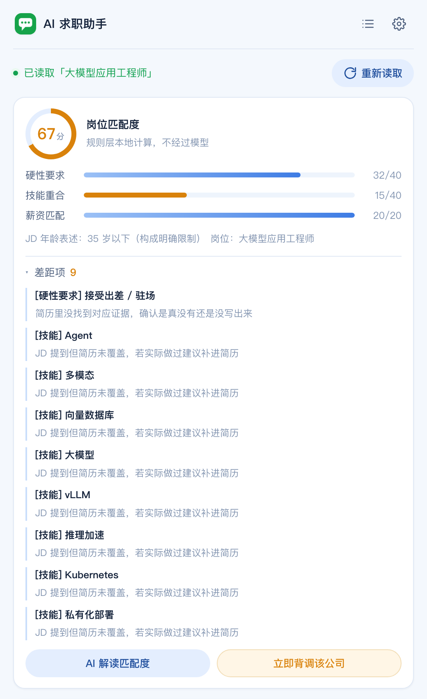
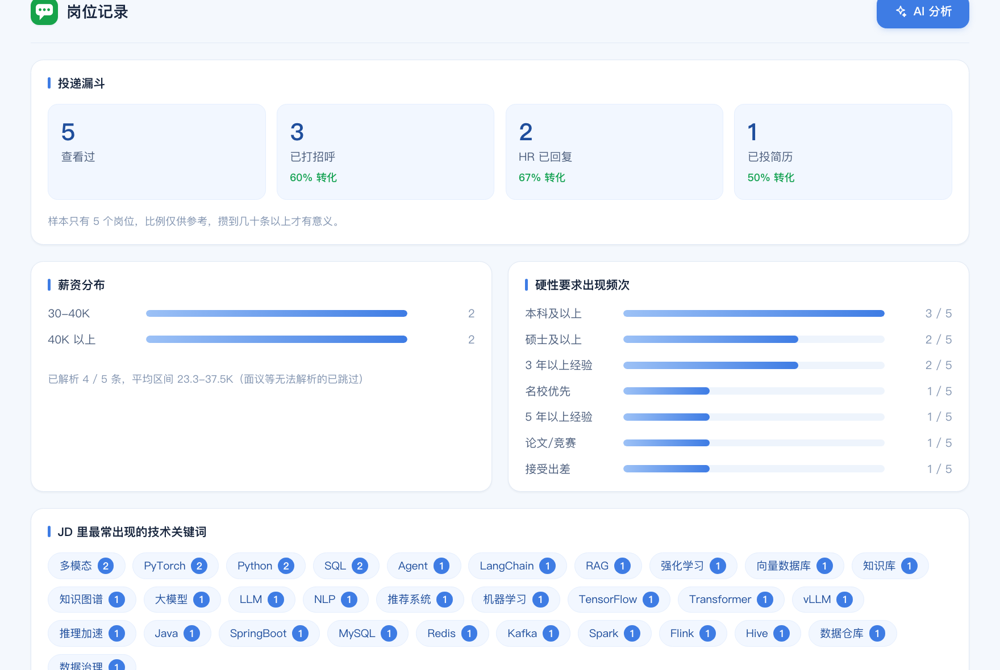

# AI 求职助手

侧边栏常驻插件。在 BOSS 职位详情页一键读取 JD，算简历匹配度，生成打招呼语；粘贴 HR 发来的消息，生成得体回复（重点覆盖期望薪资这类不可逆的追问）；投递前可对目标公司做一次结构化的求职风险背调。

只做「投递前 → 沟通中」这一段，不做完整求职工具。

**当前版本：0.13.0**

<p align="center">
  
</p>

<p align="center">
  
</p>

## 功能

- **侧边栏常驻**：点击工具栏图标（或 `⌘⇧J` / `Ctrl+Shift+J`）打开侧边栏，不会因为点击页面其他地方自动关闭，需要手动点关闭按钮才收起。切换到别的职位页时会弹窗问要不要读取（只靠 URL 判断，不预读页面），也可以随时点面板里的「重新读取」
- **岗位匹配度**：读到 JD 后自动在本地算出简历与岗位的匹配分，分三个维度——硬性要求命中率（40 分）、技能重合度（40 分）、薪资匹配度（20 分），并列出「差距项」。
  - 打分**不经过模型**。原因是模型每次采样分数会飘，同一个简历配同一个 JD 可能今天 78 明天 62，用户就没法拿分数横向比较岗位了。规则层本地算，可复现、零成本、离线可用。
  - 薪资解析不出来（写的是「面议」）时，该维度整项剔除并按剩余权重归一化，不按 0 分算——不然「面议」的岗位会平白吃亏。
  - 差距项一律标注「需人工确认」：简历里没写不等于没有，所以叫差距项，不叫不满足项。
  - 旁边的「AI 解读匹配度」会把规则层算好的分数和明细交给模型，让它解释「为什么是这个分」和「该怎么补」，并明确要求**不许改分、不许编造简历里没有的经历**。
- **背调该公司**：投递前对目标公司做一次求职风险排查。点一下，插件自动按六个维度到公开网页检索，再把结果整理成报告，**每条结论都标出来源编号**，可展开来源清单点回原文核对。检索走的是搜索服务的开放接口，不是爬虫。详见下方「背调怎么工作」
- **公司名自动提取**：从职位页读公司名时给了五条兜底路径（显式选择器 → `/gongsi/` 公司主页链接 → JSON-LD → 页面标题 → og:title）。BOSS 的 class 名换过好几轮，只靠选择器迟早失手，而失手的表现就是公司名为空、背调直接没法做。读到之后会显示在「岗位记录」卡片里让你确认，改过的公司全称会记住
- **打招呼语**：在职位详情页读取 JD（复用 `boss-jd-reader` 的严格 heading 边界提取器），结合已上传的简历生成一条 60-100 字的打招呼语。
  - **去 AI 化是这块的重点**，做法分四层（完整说明见 `prompts.js` 顶部注释）：① 提示词本身用口语写——指令越正式，模型输出越正式；② 给 4 条正面样例，覆盖不同行业和结尾方式，让模型有具体语感可模仿；③ 设置里有「我的说话风格」，填 2-3 条你自己发过的消息，模型照着模仿，**这是最有效的一招**；④ 可选「生成后自动口语化润色一遍」，拿第一稿当靶子改，比一次写好容易得多。
  - 第一版只做了「列一张禁止清单」，实测不够：负面指令（"不要写 X"）效果弱，清单列得越长反而越容易激活那些表达。
  - 温度按任务分开给：写文案 0.9 并开 `frequency_penalty`（打散模板句式），谈薪 0.6（要稳），匹配度解读 0.4，背调 0.3。
  - 生成用的提示词在 ⚙ 设置弹窗里可直接编辑，改完点「保存设置」生效，也可以随时「恢复默认」
- **换一版**：结果区除了「一键复制」还有「换一版」，用同样的输入重新生成一版，不满意直接换，不用重填 JD 和 HR 原话
- **回 HR**：粘贴 HR 的一句话，按问题类型（期望薪资 / 离职原因 / 技能追问 / 已读不回追问）生成对应策略的回复。谈薪逻辑集中写在 `prompts.js`，暂未开放到设置里（逻辑更复杂，改代码更合适）
- **简历上传**：支持 `.txt` / `.md` / `.pdf` / `.docx`，上传后本机解析并保存，「我的资料」里只显示文件名（不展示解析出的正文），可重新上传替换。PDF 用 [pdf.js](https://mozilla.github.io/pdf.js/) 提取文字，`.docx` 用 [JSZip](https://stuk.github.io/jszip/) 读取 `word/document.xml` 提取文字，两个库都本地打包在 `vendor/`，不联网、不上传文件。**旧版 `.doc`（二进制格式）不支持**，会提示先用 Word/WPS 另存为 `.docx`
- **岗位记录**：每次成功读取 JD 就自动落一条记录（岗位名、薪资、公司、JD 正文、首次/最近查看时间），主键是去掉 query 的 job_detail 路径。生成打招呼语时把文案挂到这条记录上；切回打过招呼的岗位，上一条会直接回填到结果区。四段漏斗手动标记：**查看过 → 已打招呼 → HR 已回复 → 已投简历**，「已打招呼」由插件自动推进。记录只存在 `chrome.storage.local`
- **岗位记录页**：侧边栏右上角的列表图标打开 `records.html`（新标签页）。四段投递漏斗和转化率、薪资分布、硬性要求出现频次、JD 技术关键词词频、可按状态筛选的岗位列表，以及右上角的「AI 分析」——它不在插件里跑分析，而是弹窗给出三步：导出 CSV（带 BOM）、复制一段已经填好数据规模和字段说明的提示词、把两样一起发给用户自己选的任意 AI
- **资料记忆**：简历、目前薪资、期望薪资区间保存在本机，不用每次重填

## 背调怎么工作

**检索由插件完成，不需要你动手。**

DeepSeek 的 `chat/completions` 不联网，所以背调单独接了一个搜索服务（[博查](https://open.bochaai.com/) Web Search API）。点「开始背调」之后：

1. 插件按六个维度分别检索，每个维度**限定到对应的权威域名**（用博查的 `include` 参数）：

   | 维度 | 限定域名 |
   |---|---|
   | 工商登记与经营异常 | `gsxt.gov.cn`、`creditchina.gov.cn` |
   | 被执行与失信 | `zxgk.court.gov.cn`、`creditchina.gov.cn` |
   | 劳动争议与欠薪 | `wenshu.court.gov.cn`、`creditchina.gov.cn` |
   | 工商与社保概况 | `tianyancha.com`、`qcc.com` |
   | 员工评价 | `kanzhun.com`、`maimai.cn` |
   | 综合风险 | 不限域名，兜底泛搜 |

2. 结果跨维度按 URL 去重，带上编号、来源站点、发布日期，交给模型归纳。
3. 模型输出报告，**每条事实性结论必须标引用编号**；报告底部附「来源清单」，可以点回原文核对。

### 为什么用域名限定

泛搜「某某公司 欠薪」会混进大量同名的无关公司，噪声极高。限定域名能显著提高命中质量——工商问题只查工商系统，司法问题只查法院系统。

### 这为什么不是爬虫

请求发往搜索服务的开放接口，返回的是公开网页的标题、摘要和链接。不绕过任何站点的技术防护，不注册账号，不伪造身份，不批量抓取页面正文。**插件不向任何被检索的站点直接发请求**——搜索、抓取、索引都是搜索服务自己完成的。这与「写爬虫去目标站点抓数据」是两件事。

### 报告里写死的几条约束

- 只能写检索结果里确实支持的内容，写不出引用编号的结论不许写
- 严禁根据公司名推测该公司有被执行、失信、行政处罚、经营异常、劳动仲裁、欠薪或社保欠缴
- **必须警惕同名公司**：摘要里没有出现公司全称或可辨认主体信息的，标注「疑似同名，需人工确认」
- **「没搜到」不等于「没问题」**：某维度没搜到就写「未检索到相关记录」，不写「无异常」；检索失败的维度如实写「该维度未查成」，不当成已核实
- 摘要可能是转载或旧闻，超过三年的标注「信息较旧」

### 没配搜索 Key 也能用

弹窗里保留了一条兜底路径：8 个官方查询入口（国家企业信用信息公示系统、中国执行信息公开网、中国裁判文书网、信用中国、看准网、天眼查、企查查、12333）+ 逐项判断标准，可以「复制作业单」整份带走手动查。搜索检索可能有遗漏，官方渠道永远是最准的。

插件不对任何企业作出事实认定或信用评价。

## 安全边界

- 没有常驻 content script
- service worker 里有 `chrome.tabs.onUpdated` / `onActivated` 监听器，但**只读 URL**：判断当前标签页是不是换到了另一个职位详情页，是就让侧边栏弹一个「要读取这一页的 JD 吗」的确认框。这个监听器不注入脚本、不接触页面 DOM、不发任何网络请求
- 读取 JD 只在用户点击「读取 JD」/「重新读取」（或首次打开侧边栏）时，对当前标签页注入一次只读脚本，不主动 `fetch` 任何 zhipin 接口、不自动翻页、不批量采集
- **红线是「什么时候读」，不是「知不知道换页了」**：知道 URL 变了不需要看页面内容；真正读取始终由一次点击触发，没有任何路径能在无点击的情况下拿到 JD
- **插件不代替使用者向平台发出任何动作**：不自动打招呼、不自动回复 HR、不自动投递简历。所有发送行为都由使用者在 BOSS 原生界面手动完成
- `host_permissions` 里有一条 `https://*.zhipin.com/job_detail/*`（路径限定，只到职位详情页）。这条是必要的：Side Panel 常驻不关闭，但 `activeTab` 只在点工具栏图标/快捷键这类手势时临时授予，且标签页一旦导航就失效——面板内部点「重新读取」不算这类手势。**这条权限只解决「能不能看见」，不改变「什么时候看」**
- `host_permissions` 里还有两条 API 域名：`https://api.deepseek.com/*`（生成文案）和 `https://api.bocha.cn/*`（背调检索）。都是写死的，不开放配置，所以各只需要一个域名。这两条只用于让侧边栏页面的 `fetch` 绕过 CORS
- 简历、薪资、API Key 只存在 `chrome.storage.local`，不上传到除你自己配置的模型接口以外的任何地方
- `background.js` 唯一职责是设置「点图标打开侧边栏」，不做任何监听、抓取或网络请求

产生风险的是「主动发请求」（自动抓取列表、批量打开详情页、代替用户发消息），不是「读一眼用户自己已经打开的这一页」。

## 免责声明

本插件为个人求职辅助工具，仅提供信息整理与文本生成辅助，不构成任何法律、财务、征信或职业决策建议。所有输出内容仅供参考，最终判断与决策由使用者自行作出。

插件的文案与报告均由第三方大语言模型生成，可能存在错误、遗漏、过时或不当表述，使用前请务必自行核实。

背调报告整理自公开网页的检索结果，未经人工核实，可能存在同名主体混淆、信息过时或转载失真。插件不对任何企业作出事实认定或信用评价。使用者不得将报告用于对外发布、商业决策、信贷评估或任何可能损害第三方合法权益的用途。

插件不会代替使用者向任何平台发出请求或执行操作，使用者仍需自行遵守目标平台（包括但不限于 BOSS 直聘）的用户协议与相关规则。因使用本插件产生的账号限制、封禁或其他不利后果，由使用者自行承担。

插件无服务器，不向作者上传任何数据；简历、薪资、API Key、岗位记录全部存储在使用者本机浏览器且未加密，请勿在公用设备上使用。使用者自行配置的第三方服务会接收完成功能所必需的内容：模型服务接收简历与 JD 文本，搜索服务接收待背调的公司名称。

在法律允许的最大范围内，作者不对因使用或无法使用本插件而产生的任何直接或间接损失承担责任。

完整版本见插件内「免责声明」（侧边栏底部）与 `legal.js`。

## 加载方式

1. 打开 `chrome://extensions`，开启「开发者模式」
2. 「加载已解压的扩展程序」，选择本目录
3. 点击扩展图标（或按 `⌘⇧J` / `Ctrl+Shift+J`）打开侧边栏
4. 展开右上角设置图标，上传简历、填写薪资区间和模型 API 信息，保存

## 模型接口配置

模型地址与搜索服务地址都写死，不开放配置。设置里需要填三样：

| 项 | 说明 |
|---|---|
| 模型名称 | 保持 `deepseek-chat` |
| API Key | 在 [DeepSeek 开放平台](https://platform.deepseek.com/api_keys) 创建。费用直接结算给 DeepSeek，生成一条文案通常不到一分钱 |
| 搜索 API Key | 在 [博查 AI 开放平台](https://open.bochaai.com/) 注册获取，按次计费、注册后有免费额度。**只用于背调**，不填也能用插件，只是背调退回手动查 |

背调一次会发 6 次检索请求，成本取决于博查的计费档位。

## 界面

主色为浅蓝。设计令牌集中在 `sidepanel.css` 的 `:root`，`records.css` 复用同一套——**改色只改 `:root`**，两个页面一起变。

- 侧边栏与记录页共用一套令牌与组件（按钮、弹窗、表单、卡片、状态标签）
- 交互：弹窗淡入上浮、标签页为分段控件、输入框 `focus-within` 高亮、生成中按钮带转圈、匹配度为环形仪表、状态提示淡入、来源清单可展开
- 尊重 `prefers-reduced-motion`：系统开启「减弱动态效果」时所有动画自动关闭
- 弹窗结构为「头 / 可滚动主体 / 底」三段，内容再长也不会把关闭按钮顶出屏幕
- 所有类名都有对应样式，重写样式后跑过一遍「用到的类 × 已定义的类」对照检查

## 第三方库

`vendor/` 目录下打包了两个开源库（均为静态本地文件，manifest V3 不允许加载远程脚本，也不用 CDN）：

| 库 | 用途 | 许可证 |
|---|---|---|
| [pdf.js](https://mozilla.github.io/pdf.js/) 4.10.38 | 解析 `.pdf` 简历，提取文字 | Apache-2.0，见 `vendor/pdfjs/LICENSE` |
| [JSZip](https://stuk.github.io/jszip/) 3.10.1 | 解压 `.docx`（本质是 zip），读取正文 XML | MIT/GPLv3 双许可，见 `vendor/jszip/LICENSE.markdown` |

## 代码结构

```
.
├── ai-job-assistant/     扩展本体，这个目录就是「加载已解压的扩展程序」要选的那个
├── tools/                开发用脚本，不随扩展分发
│   ├── 生成预览.py        产出静态 UI 预览页
│   ├── 生成使用说明.py     产出 ai-job-assistant/使用说明.docx
│   ├── _预览脚本.js        侧边栏预览的演示数据
│   └── _预览脚本_记录页.js  记录页预览的演示数据
└── docs/                 README 用的截图
```

扩展本体的模块划分：

| 文件 | 职责 |
|---|---|
| `background.js` | Service Worker，只做两件事：设置侧边栏打开行为、只读 URL 判断换页 |
| `sidepanel.html/css/js` | 侧边栏主界面：打招呼、回 HR、设置、岗位记录卡 |
| `insight.js` | 匹配度展示 + 背调流程，DOM 与状态闭环在自己手里 |
| `matcher.js` | 匹配度规则层打分、年龄提取、技能词表（记录页也复用这份词表） |
| `backcheck.js` | 背调的兜底路径：8 个官方查询入口、逐项判断标准、作业单文本 |
| `search.js` | 背调检索层：六个检索维度与域名限定、博查 API 请求构造与响应解析、结果编号与来源清单 |
| `prompts.js` | 全部系统提示词（去 AI 化约束集中在这里） |
| `legal.js` | 免责声明文本与作者信息，单一来源 |
| `extractor-page.js` | 注入脚本，严格 heading 边界提取 JD |
| `job-store.js` | 存储层、漏斗状态机、薪资解析 |
| `resume-parser.js` | 简历文本提取（txt/md/pdf/docx） |
| `records.html/css/js` | 岗位记录页（新标签页仪表盘） |

## 本地测试

```bash
python3 -m json.tool manifest.json
node --check background.js
node --check extractor-page.js
for f in sidepanel.js records.js job-store.js prompts.js resume-parser.js \
         matcher.js backcheck.js legal.js insight.js; do
  node --input-type=module --check < "$f"
done
```

`matcher.js` 与 `backcheck.js` 不依赖 DOM 和 `chrome.*`，可以直接在 Node 里 import 做逻辑断言（薪资解析、年龄提取、技能词边界、无材料时禁止编造等）。

## 限制

- JD 提取依赖 BOSS 页面结构，改版后选择器可能需要更新
- 匹配度是规则层打分，简历里的年限、项目成果如果写法不常规，可能识别不到，会体现为「差距项」而不是扣分——这是有意为之，宁可提示人工确认，也不要给一个看起来精确但错误的分数
- 背调不联网，事实部分完全依赖使用者自行查询并提供的材料
- 简历支持 `.txt` / `.md` / `.pdf` / `.docx`；扫描版（图片）PDF 提取不出文字会报错；旧版 `.doc` 不支持
- 侧边栏常驻但不会跟随标签页自动换 JD，切页后需要手动点「重新读取」（有意为之：每次读取都要求一次明确的用户动作）
- 谈薪逻辑是首版默认策略，写在 `prompts.js` 顶部，建议按本人真实谈薪经验继续打磨
- **打招呼语的去 AI 化程度取决于「我的说话风格」填得好不好**。不填也能用，但默认提示词给的是一般化的口语样例；填 2-3 条你自己的真实消息，效果差异很明显
- 如果之前保存过自定义的打招呼提示词，升级后不会自动换成新默认值，需要在设置里点一次「恢复默认」
- API Key 明文存在本机 `chrome.storage.local`，不要在公用电脑上保存

## 附：UI 预览

`tools/` 下有一套静态预览生成脚本，不加载扩展也能看界面：

```bash
python3 tools/生成预览.py
```

产出两份预览：`预览_v0.13.0.html`（侧边栏）与 `预览_记录页_v0.13.0.html`（岗位记录页）。
它把 `sidepanel.html` / `records.html` 的 body 原样取出、内联 CSS 与引擎代码，再用 `tools/_预览脚本*.js` 灌演示数据。

新增模块时记得补进 `tools/生成预览.py` 的 `ENGINE` 列表，否则预览里引用到该模块会整段脚本中断。

## 开源协议

[MIT](LICENSE)。

`ai-job-assistant/vendor/` 下打包的两个第三方库各自遵循其原许可证：pdf.js 为 Apache-2.0（见 `vendor/pdfjs/LICENSE`），JSZip 为 MIT/GPLv3 双许可（见 `vendor/jszip/LICENSE.markdown`）。分发时保留这两个 LICENSE 文件即可。

## 作者

NicoShao
